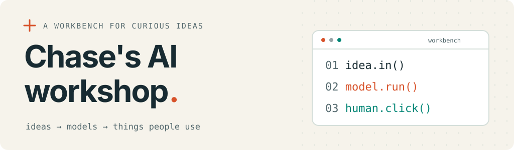

<picture>
  <source media="(prefers-color-scheme: dark)" srcset="./assets/workshop-dark.svg">
  <source media="(prefers-color-scheme: light)" srcset="./assets/workshop-light.svg">
  
</picture>

### I build AI products and the systems that put agents to work.

I'm **Chase Wu**. My current work spans **AI products, agent orchestration, and reliable delivery**. I care about the whole loop: a useful experience, clear execution, and knowing whether the result actually works.

Curious ideas welcome. So are the awkward edge cases.

## On the workbench

**AI products people can use**  
I work on document and conversational AI experiences, from model workflows and quality checks to permissions and billing. That includes what happens when a model call fails, a job stalls, or the output needs another pass.

**Putting agents to work**  
I'm developing ways to give agents scoped tasks, persistent context, and isolated workspaces. Clear ownership, explicit dependencies, and verification help keep concurrent work reviewable.

**Reliable delivery**  
I work across local and cloud environments to connect product changes with CI, observability, and recovery. Shipping includes investigating what went wrong and making the next attempt better.

## How I work

`idea → scoped tasks → agents → verify → iterate`

Keep the context. Check the result. The logs get a vote.

Tools in rotation: **TypeScript / Bun · Python · Rust**.

## Let's build something with AI

I'd love to hear about **AI products, agent workflows, and developer tools**. I can help shape the product, organize agent work, and carry changes through verification and delivery.

**[Tell me what you're building →](mailto:chase_wu@meside.com)**  
Send the goal, the current stage, and the part you'd like help with. A repo or demo link is a great starting point.
